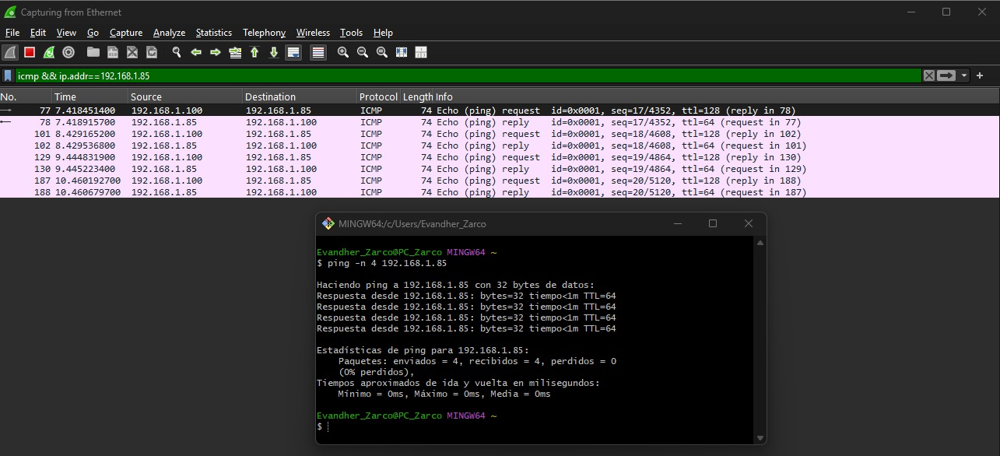
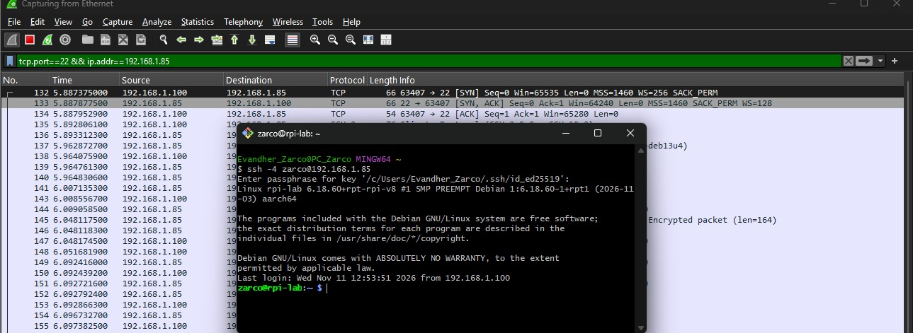
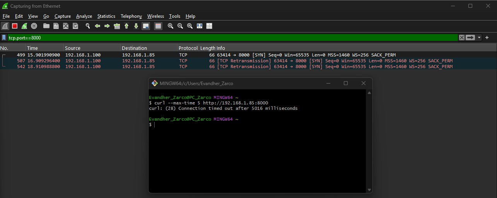

# rpi-firewall-lab

## ¿Qué es?

Es un servidor Linux headless (sin monitor ni teclado) en una Raspberry Pi 3 Model B. Está conectado a la red de mi casa por cable Ethernet y lo administro de forma remota por SSH desde mi PC.

Es un laboratorio para practicar acceso remoto seguro, configuración de un firewall con ufw y análisis de tráfico con Wireshark.

## Hardware y software

- Raspberry Pi 3 Model B v1.2
- microSD Kingston Canvas Select Plus de 64 GB (A1)
- Raspberry Pi OS Lite 64-bit (basado en Debian 13 "trixie"), grabado con Raspberry Pi Imager v2.0.12
- PC con Windows y Git Bash como terminal
- Wireshark 4.6.9 (con Npcap)

## Estado

- ✅ Sistema instalado y actualizado (`apt full-upgrade`; kernel verificado con `uname -r` después de reiniciar: 6.18.60)
- ✅ Acceso remoto por SSH con llave ed25519
- ✅ Firewall ufw: denegar por defecto lo que entra y permitir SSH solo desde mi red local
- ✅ Prueba de un puerto bloqueado y después abierto
- ✅ Capturas en Wireshark: ICMP, saludo TCP y una conexión bloqueada

## ¿Por qué SSH con llave y no con contraseña?

Con contraseña, aunque SSH la manda cifrada, la contraseña completa llega a la Pi. Con llave, la Pi me manda un reto y mi PC lo firma con la llave privada: solo viaja la firma, nunca la llave. Además, no se puede adivinar probando combinaciones. La Pi solo tiene la llave pública, y la llave privada está protegida con una frase.

## Red

La Pi obtiene su IP por DHCP del módem (en mi red quedó en 192.168.1.85). Como la asigna el módem, puede cambiar; reservarla está pendiente.
- PC (192.168.1.100), misma red 192.168.1.0/24, sin router entre ellas

## Firewall con ufw

- Se le asignó una politica para que niega todo lo que entra, permita todo lo que sale, y como excepción permite SSH (22/tcp) solo desde 192.168.1.0/24.

- Salida de ufw status verbose:

zarco@rpi-lab:~ $ sudo ufw status verbose
Status: active
Logging: on (low)
Default: deny (incoming), allow (outgoing), disabled (routed)
New profiles: skip

To                         Action      From
--                         ------      ----
22/tcp                     ALLOW IN    192.168.1.0/24


| Prueba | Comando | Resultado | ¿Esperado? |
|---|---|---|---|
| SSH por IPv4 | `ssh -4 zarco@rpi-lab.local` | Entra | Sí |
| SSH por IPv6 por nombre | `ssh -6 ... rpi-lab.local` | Cannot assign requested address | Windows no pudo establecer la conexión con la dirección que le dio el nombre. Como no se estableció conexión con la Pi, la prueba no cuenta ni a favor ni en contra |
| SSH por IPv6 global | `ssh -6 ... 2806:xxxx:...` | Connection timed out | Sí, bloqueado |

## Prueba de puerto bloqueado y abierto

```bash
# Pi: servidor de prueba
python3 -m http.server 8000
# PC: intento de conexión
curl --max-time 5 http://192.168.1.85:8000
# Pi: abrir y luego cerrar el puerto
sudo ufw allow from 192.168.1.0/24 to any port 8000 proto tcp
sudo ufw delete allow from 192.168.1.0/24 to any port 8000 proto tcp
```

| Paso | Resultado | Qué demuestra |
|---|---|---|
| curl con el puerto cerrado | timeout tras 5003 ms | ufw descarta en silencio (no responde "rechazado") |
| curl con el puerto abierto | HTML + `GET / 200` en la Pi | la regla abre exactamente ese puerto |
| curl después de borrar la regla | timeout tras 5008 ms | borrar la regla sí cierra el puerto |
| `ufw status verbose` | solo queda el 22 | la Pi quedó como estaba |


## Análisis de tráfico con Wireshark

### ICMP (ping)



- El Firewall NO bloque ping debido a que tiene una configuración por defecto que está por encima de estas reglas. El ping se permite para para diagnosticar, sabiendo que revela que la Pi está activa

### Saludo TCP



- Muestra como la Pi habla por el puerto 22 y la PC le responde por un puerto aleatorio para evitar conflicto de direcciones

### Conexión bloqueada



- El puerto 8000 fue bloqueado por Firewall, se ejecutó el conmando con --max-time 5 lo que le permitió hacer dos retransmisiones hasta que se agotó el tiempo. Lo que significa que la respuesta al firewall es silecion, lo que lanza el timed out


## Decisiones y límites

**Decisiones**

- SSH solo desde mi red local (192.168.1.0/24) y sollo por IPv4.
- La Pi responde ping a cualquier equipo de la red local. Es el comportamiento por defecto de ufw (`/etc/ufw/before.rules`, línea 37) y lo dejé así para poder diagnosticar la conexión.
- El firewall descarta en silencio en vez de rechazar: quien escanea no recibe respuesta, solo un timeout.

**Límites**
- La IP la asigna el módem por DHCP; si cambia, los comandos con 192.168.1.85 dejan de servir. Reservarla está pendiente.
- ufw protege solo a la Pi, no al resto de la red.
- Las pruebas las hice desde un solo equipo, dentro de la misma red.
- Las capturas se tomaron desde mi PC, no desde la Pi: muestran lo que mi PC envió y recibió.


## Bitácora

### 09/11/2026: diagnóstico de hardware e instalación

**Problema:** tenía dos Raspberry Pi 3 y creía que una no funcionaba. Con la microSD que venía con ellas, el LED verde (actividad de la tarjeta) no encendía en ninguna de las dos placas.

**Diagnóstico por descarte:**
- La fuente daba suficiente corriente: el LED rojo se mantenía fijo.
- Probé la misma microSD en la otra placa y la tarjeta se calentó mucho.
- La PC tampoco reconocía la microSD.
- Conclusión: la falla estaba en la tarjeta, no en las placas.

**Solución:** compré una microSD nueva, la grabé con Raspberry Pi Imager y verifiqué la escritura. Ambas placas arrancaron correctamente y obtuvieron IP en la red.

**Lo que aprendí:**
- Confirmé conectividad con `ping` (respuestas con TTL=64, valor típico de Linux).
- Mi primer intento de SSH falló con `Permission denied (publickey)` porque usé el nombre del equipo (`rpi-lab`) como usuario. Con el usuario correcto funcionó.
- Al pasar la misma microSD de una placa a otra, la huella SSH del servidor fue la misma: la identidad del servidor y los usuarios viven en la tarjeta, no en la placa. Lo que sí cambió fue la IP, porque cada placa tiene su propia MAC.

### 10/11/2026: firewall e IPv6

**Problema:** Cuando se intentó entrar por ssh la terminal se congelo y después pidió la passphrase.

**Diagnóstico:** la regla que permite SSH solo cubre mi red IPv4 (192.168.1.0/24). Al conectarme con `rpi-lab.local`, el nombre resolvía a dos IP's, una IPv4 y una IPv6. La PC intentó conectarse usando la IPv6 ya que la prefiere, sin embargo,nunca llegó a la Pi, por lo que cambió a la IPv4 y logró acceder con ella, pidiendo la passphrase.

**Solución:** me conecto con `ssh -4` para forzar IPv4, y verifiqué que por IPv6 la conexión queda bloqueada.

**Lo que aprendí:** un firewall tiene que cubrir IPv4 e IPv6 por separado; si solo pienso en IPv4, puede quedar una entrada que no consideré.

### 11/11/2026: prueba de puerto y Wireshark

**Problema 1:** para probar el puerto 8000 levanté `python3 -m http.server` en mi carpeta personal. Mientras el puerto estuvo abierto, cualquier equipo de la red podía ver mis archivos, incluidos `.ssh/` y `.bash_history`.

**Lo que aprendí:** el firewall controla **quién** entra, pero no **qué** expone el servicio que abro. Para pruebas así, uso una carpeta vacía.

**Problema 2:** al buscar en `/etc/ufw/before.rules` por qué el ping pasaba el firewall, `grep` respondió `Permission denied`.

**Diagnóstico:** no era el firewall, sino los permisos del archivo (`-rw-r-----`, dueño `root`): mi usuario no puede leerlo.

**Solución:** con `sudo grep` encontré la línea que acepta el ping entrante.

**Lo que aprendí:** distinguir un error de permisos de Linux de un bloqueo de red.